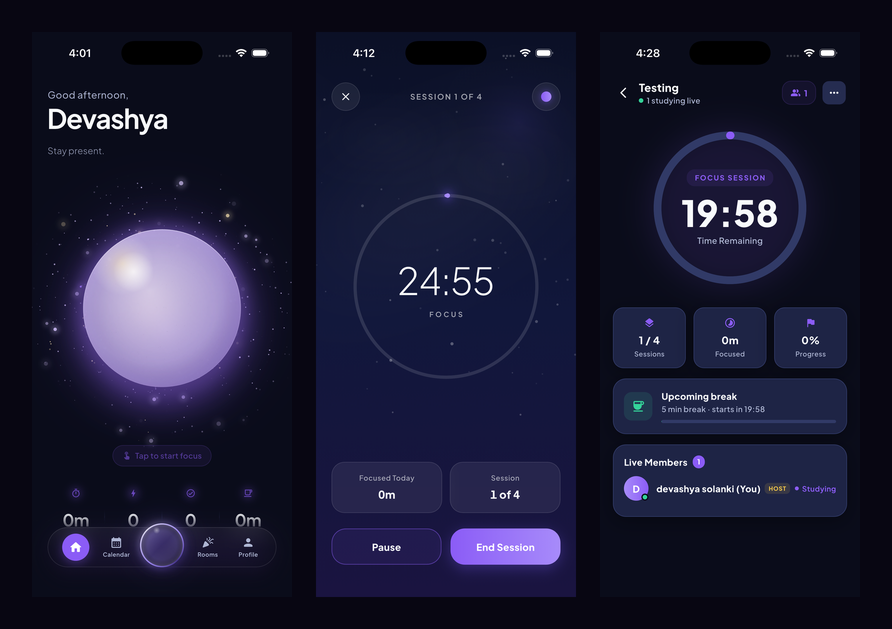

<div align="center">

# Devashya Solanki

### Software Engineer · Mobile & Full-Stack

Building production-quality applications with an obsession for user experience,
security, and code that stays maintainable after the first thousand commits.

<a href="https://github.com/NotDvsh"></a>
<a href="mailto:devashyasolanki1234@gmail.com"></a>
<a href="#"></a>

<br/>


</div>

---

## 📌 Projects

| Project | What it is | Stack | Status |
| :--- | :--- | :--- | :---: |
| **[Focal ↗](projects/focal/README.md)** | Cross-platform focus & study app with real-time multiplayer study rooms | Flutter · Firebase · Swift | ✅ Built |
| **[Journal.io ↗](projects/journal-io/README.md)** | _Coming soon_ | — | 🚧 In progress |
| **[AI Game Replay Analyzer ↗](projects/ai-game-replay-analyzer/README.md)** | _Coming soon_ | — | 🚧 In progress |
| **[Simulator Assembler ↗](projects/simulator-assembler/README.md)** | _Coming soon_ | — | 🚧 In progress |

---

<br/>

## 🌌 Focal

> **Focus on what matters.** A goal-driven focus companion that turns study intentions into tracked, shared, and rewarded sessions.

<div align="center">

</div>

<br/>

Most productivity apps stop at a timer. Focal closes the whole loop — set a goal,
schedule it, focus on it in a distraction-shielded session, watch the progress
accumulate, and when motivation runs thin, do it alongside other people in a
synchronized study room.

**Highlights**

- Real-time multiplayer study rooms where every device stays in perfect agreement, including late joiners
- Distraction blocking through native iOS Screen Time, behind a platform-agnostic interface
- Eight full visual environments that animate a recolor of the entire application
- Authorization enforced at the database layer, so a tampered client can't escalate privileges
- Invite deep links that survive a cold start and an unauthenticated recipient
- Recurring goals, achievements, streaks, and focus analytics

<sub>Flutter · Dart · Firebase · Swift · ~47,000 lines of Dart · 30+ screens</sub>

<div align="left"><b><a href="projects/focal/README.md">Read the full Focal case study →</a></b></div>

---

<br/>

## 📓 Journal.io

> 🚧 **In progress** — case study coming soon.

<div align="left"><b><a href="projects/journal-io/README.md">View project →</a></b></div>

---

<br/>

## 🎮 AI Game Replay Analyzer

> 🚧 **In progress** — case study coming soon.

<div align="left"><b><a href="projects/ai-game-replay-analyzer/README.md">View project →</a></b></div>

---

<br/>

## ⚙️ Simulator Assembler

> 🚧 **In progress** — case study coming soon.

<div align="left"><b><a href="projects/simulator-assembler/README.md">View project →</a></b></div>

---

<br/>

## 📁 Repository Structure

```
.
├── README.md                          ← you are here
└── projects/
    ├── focal/
    │   ├── README.md                  ← full case study
    │   └── assets/                    ← screenshots
    ├── journal-io/
    ├── ai-game-replay-analyzer/
    └── simulator-assembler/
```

Every project follows the same layout: **Hero · Overview · Features · Screenshots ·
Tech Stack · My Contributions · Challenges Solved · Key Takeaways.**

---

<div align="center">

### Let's build something

<a href="mailto:devashyasolanki1234@gmail.com"></a>
<a href="https://github.com/NotDvsh"></a>

<sub>Open to software engineering internship and new-grad opportunities.</sub>

</div>
