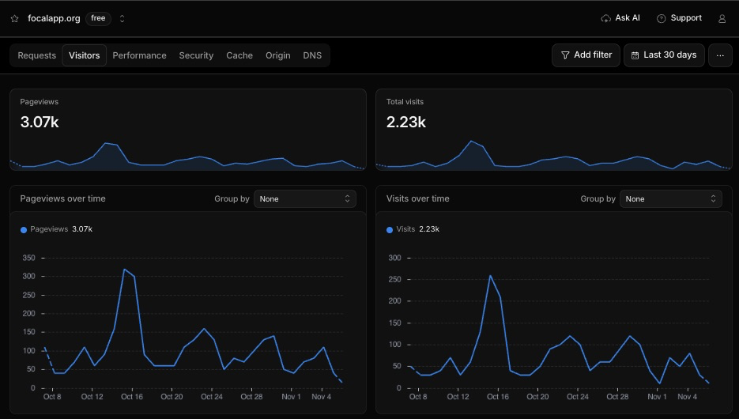
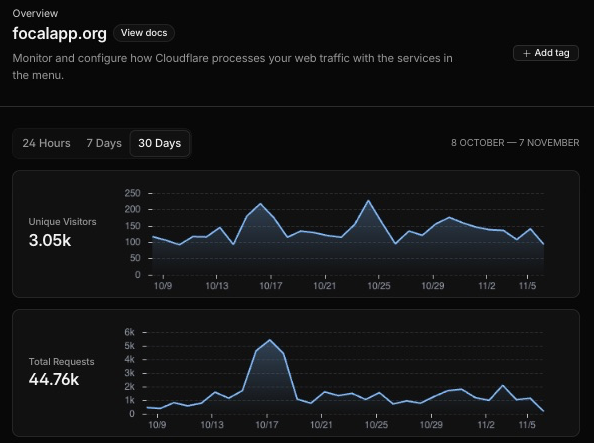

# Focal website traction

**October 8–November 7, 2026 · 30-day snapshot**

Focal’s website recorded **2,230 visits** and **3,070 pageviews** over 30 days. The landing page introduces Focal for iPhone and gives prospective users a place to preregister. [Visit focalapp.org →](https://focalapp.org/)

| Metric | 30-day total | Cloudflare view |
| --- | ---: | --- |
| Visits | **2,230** | Analytics → Visitors |
| Pageviews | **3,070** | Analytics → Visitors |
| Unique visitors | 3,050 | Zone Overview |
| HTTP requests | 44,760 | Zone Overview |

## Dashboard screenshots

*Analytics → Visitors. Both charts show a mid-October spike, followed by smaller peaks later in the month.*

*Zone Overview. The selected 30-day range and date labels are visible above the charts.*

## How the figures were measured

The totals use Cloudflare’s rounded dashboard figures for the `focalapp.org` zone. A visit can include several pageviews. Cloudflare counts successful HTML responses as pageviews and uses IP addresses to estimate unique visitors. Zone traffic can include crawlers and other automated requests. [Cloudflare Zone Analytics](https://developers.cloudflare.com/analytics/account-and-zone-analytics/zone-analytics/) · [Cloudflare Analytics FAQ](https://developers.cloudflare.com/analytics/faq/about-analytics/)

[Back to the Focal case study →](README.md)
