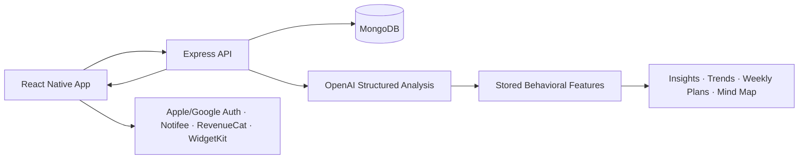

# 📓 Journal.IO

> **Reflection that adds up.** A privacy-conscious mobile journaling app that turns private writing into understandable trends and practical next steps.

---

## Overview

**Journal.IO** helps people build a consistent reflection habit — daily writing, mood
tracking, searchable history, and supportive AI-powered pattern summaries.

**The problem:** most journals store thoughts but do nothing with them. People write
for months and still can't see the recurring themes, mood shifts, or habits sitting in
their own words.

**The approach:** Journal.IO reads back what you've written and surfaces it as trends
and concrete next steps — deliberately framed as supportive observations, never as
clinical or diagnostic claims.

**Who it's for:** anyone who wants journaling to compound instead of accumulate.

🔗 **See it live — [journalio.app](https://journalio.app)**

---

## ✨ Features

### ✍️ Journaling

| Feature | Description |
| :--- | :--- |
| **Daily Entries** | Plain-text writing with create, edit, and delete, built for speed rather than formatting. |
| **Mood Check-Ins** | Lightweight mood capture attached to each entry, so feeling and context stay linked. |
| **Tags** | Manual tagging plus AI-suggested tags for Premium users, making months of writing navigable. |
| **Calendar History** | A date-based view of everything written, so the habit is visible at a glance. |
| **Search** | Full search across entries to find a moment, a theme, or a recurring phrase. |

### 🧠 Insights

| Feature | Description |
| :--- | :--- |
| **Analytics Dashboard** | Mood, topic, and behavioral-pattern trends drawn from actual entries. |
| **Weekly Insights** | AI-assisted summaries that name what recurred this week and suggest a practical action plan. |
| **Mind Map** | An interactive map of how themes in a person's reflections connect to one another. |
| **Non-Clinical by Design** | Insights are framed as observations and suggestions — the product makes no diagnostic claims. |

### 🎯 Habit & Motivation

| Feature | Description |
| :--- | :--- |
| **Goals & Streaks** | Reflection goals with streak tracking to sustain the habit past the first week. |
| **Achievements** | Milestones that reward consistency rather than volume. |
| **Daily Reminders** | Local notifications at a user-chosen time, scheduled on-device. |
| **iOS Widgets** | Home-screen Quick Thought, Mood Check-in, and Streak widgets for zero-friction capture. |

### 🔐 Privacy & Account

| Feature | Description |
| :--- | :--- |
| **AI Opt-Out** | Users can switch off AI processing entirely and keep the full journaling experience. |
| **Biometric Lock** | Face ID / Touch ID gate on iOS for a genuinely private notebook. |
| **Hidden Entries** | Individual entries can be kept out of normal browsing. |
| **Data Export & Deletion** | Full self-service export and account deletion, not a support request. |
| **Authentication** | Email/password, Google, and Apple sign-in, with email verification and password reset. |

### 💳 Monetization & Experience

| Feature | Description |
| :--- | :--- |
| **Subscriptions** | RevenueCat-backed plans with clean premium feature gating. |
| **Guided Onboarding** | A first-reflection flow that gets users writing before it asks for anything. |
| **Themes & Haptics** | Appearance preferences and tactile feedback throughout. |

---

## 🛠 Tech Stack

| Layer | Technology |
| :--- | :--- |
| **Mobile** | React Native · React 19 · TypeScript · React Navigation |
| **State Management** | Zustand |
| **Backend** | Node.js · Express 5 · TypeScript |
| **Validation** | Zod |
| **Database** | MongoDB · Mongoose |
| **AI** | OpenAI API — structured, non-blocking journal analysis |
| **Authentication** | JWT · Apple Sign In · Google Sign-In |
| **Secure Storage** | React Native Keychain · AsyncStorage |
| **Notifications** | Notifee (local) |
| **Payments** | RevenueCat · StoreKit |
| **Native iOS** | SwiftUI · WidgetKit |
| **Deployment** | Render · MongoDB Atlas · App Store Connect |
| **Testing & Quality** | Jest · React Test Renderer · ESLint · TypeScript |

---

## 🏗 Architecture

**Guiding rules**

- **AI never blocks the user.** Analysis runs out of band; writing or reading an entry never waits on a model call.
- **Derived once, not re-derived.** Behavioral features are computed and stored, so insights, trends, and the Mind Map all read from the same source instead of re-analyzing text on every view.
- **Validated boundaries.** Every API surface is schema-validated before it reaches business logic.
- **Privacy as a switch, not a promise.** Opting out of AI is a real code path, not a settings toggle that changes nothing.

---

## 👤 My Contributions

I designed and built Journal.IO end to end — the React Native experience, the
Express/MongoDB backend, authentication, journaling workflows, the AI insight
pipeline, privacy controls, subscription flows, reminders, and iOS widgets — along
with product UX, App Store readiness, testing, and deployment.

| Area | What I built |
| :--- | :--- |
| **Authentication** | Email/password, Google, and Apple sign-in, with email verification and password reset. |
| **Journaling Core** | Entry writing, mood tracking, tagging, editing, calendar history, and search. |
| **AI Pipeline** | Tag suggestions, behavioral insights, weekly plans, guided reflection, and the Mind Map. |
| **Habit Systems** | Goals, streaks, achievements, and local reminder scheduling. |
| **Monetization** | RevenueCat entitlement handling, paywalls, subscriptions, and App Store lifecycle fixes. |
| **Privacy** | Biometric lock, hidden entries, data export and deletion, and safe AI opt-out behavior. |
| **Native iOS** | Home-screen widgets and the native bridges behind them. |
| **Experience & Quality** | Onboarding, themes, haptics, responsive polish, tests, architecture docs, and deployment setup. |

139 non-merge commits, all authored by me.

---

## 🧩 Challenges Solved

<b>Making AI useful without making it intrusive</b>

 

A journaling app that sends every private thought to a model is a hard sell, and one
that blocks the writing screen on a network call is worse.

**Outcome:** analysis is structured and non-blocking, results are stored as reusable
features rather than repeated text round-trips, and opting out disables the pipeline
entirely while leaving the app fully functional.

<b>Turning free-form text into trends worth showing</b>

 

Raw entries are unstructured and inconsistent. Charting them naively produces noise,
and re-analyzing history on every dashboard view doesn't scale.

**Outcome:** entries are distilled once into stored behavioral features that the
analytics dashboard, weekly plans, and Mind Map all read from — consistent numbers,
fast views, one source of truth.

<b>Being supportive without overstepping</b>

 

Language about mood and behavior slides very easily into sounding clinical, which is
both irresponsible and a real App Store risk.

**Outcome:** insights are deliberately scoped to observation and practical suggestion,
with no diagnostic framing anywhere in the product.

<b>Shipping a real subscription product</b>

 

Entitlements, restores, expiry, and store-side lifecycle events are where most
independent apps quietly break.

**Outcome:** a RevenueCat-backed subscription layer with clean gating, handled
lifecycle transitions, and a paywall that degrades gracefully when the store is
unavailable.

<b>Closing the gap between thought and capture</b>

 

The distance between having a thought and opening an app is where journaling habits
die.

**Outcome:** iOS home-screen widgets for quick thoughts, mood check-ins, and streaks,
backed by native bridges, so capture takes one tap.

---

## 🎯 Key Takeaways

- **Full-stack ownership.** Mobile client, API, database, AI pipeline, native modules, payments, and deployment — designed and shipped by one person.
- **Responsible AI product sense.** The hard part wasn't calling a model; it was deciding what the model is allowed to say, and what happens when a user says no.
- **Privacy as architecture.** Opt-out, biometric lock, export, and deletion are structural features, not settings-screen decoration.
- **Native fluency where it counts.** SwiftUI and WidgetKit used precisely where React Native alone couldn't deliver the experience.
- **Production discipline.** Typed end to end, schema-validated at the boundaries, tested, documented, and deployed.

---

## 🔭 Future Improvements

- **Android widgets** to match the iOS home-screen experience
- **Offline-first sync** with queued writes that reconcile on reconnect
- **Richer Mind Map interaction** — filtering, time-scoping, and theme drill-down
- **Expanded test coverage** across the AI pipeline and subscription flows
- **Localization** beyond English
- **Accessibility audit** for screen readers, contrast, and dynamic type

---

<a href="../../README.md">← Back to portfolio</a>

